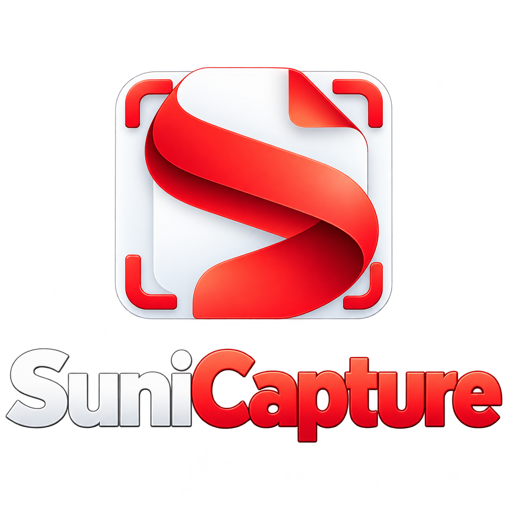
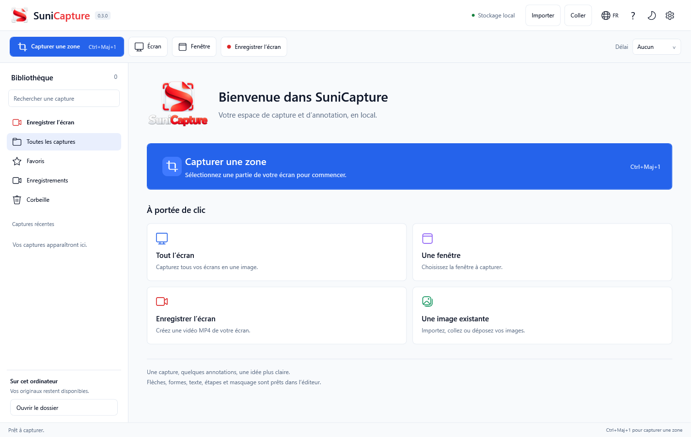
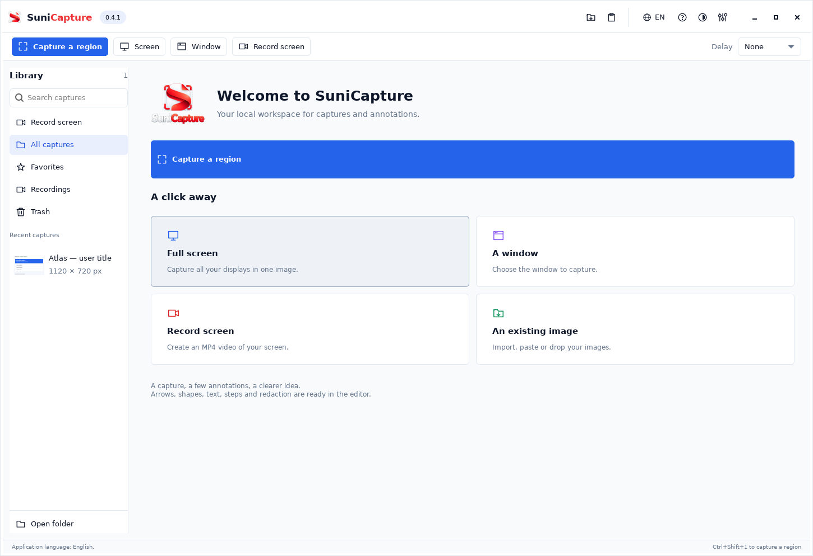
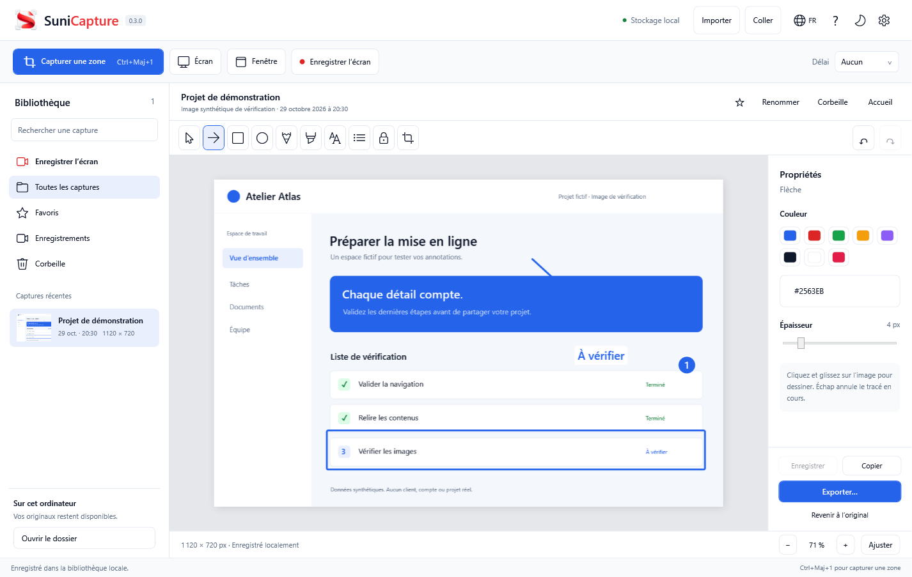

<p align="center"></p>

# SuniCapture

**Capture, annotate and record your screen locally.**

Desktop app for **Windows and Linux x64**, with a local library, image editor and MP4 recording. Available in French and English, with light and dark themes. No account, application telemetry or capture uploads.

[Download the latest version](https://github.com/lmdanavanem/SuniCapture/releases/latest) · [All releases](https://github.com/lmdanavanem/SuniCapture/releases) · [Français](README.fr.md) · [Report an issue](https://github.com/lmdanavanem/SuniCapture/issues)



## Download and run

| Platform | Download | Requirements |
|---|---|---|
| Windows x64 | [Portable ZIP](https://github.com/lmdanavanem/SuniCapture/releases/download/v0.4.1/SuniCapture-0.4.1-win-x64.zip) | Windows desktop; .NET included |
| Linux x86_64 | [Debian/Ubuntu installer](https://github.com/lmdanavanem/SuniCapture/releases/download/v0.4.1/SuniCapture-0.4.1-linux-amd64.deb) | Debian 12+ / Ubuntu 22.04+; system dependencies installed by apt |
| Linux x86_64 | [Archive](https://github.com/lmdanavanem/SuniCapture/releases/download/v0.4.1/SuniCapture-0.4.1-linux-x64.tar.xz) | Python 3.10+, GTK and multimedia packages; [instructions](docs/linux.md) |

### Windows

1. Download **SuniCapture-0.4.1-win-x64.zip** from [release 0.4.1](https://github.com/lmdanavanem/SuniCapture/releases/tag/v0.4.1).
2. Extract the **complete folder** to a location of your choice.
3. Open **SuniCapture.exe** inside the extracted folder.

The distribution includes .NET. No .NET installation or administrator rights are required. Keep all accompanying files next to the executable. Compare the following result with **SHA256SUMS.txt** attached to the release:

```powershell
Get-FileHash .\SuniCapture-0.4.1-win-x64.zip -Algorithm SHA256
```

### Linux

Download the `.deb`, then install and start the application:

```sh
sudo apt install ./SuniCapture-0.4.1-linux-amd64.deb
sunicapture
```

The application also appears in your desktop menu. The validated Linux capture session is **X11/Xorg**. Wayland capture uses system permission dialogs and PipeWire; it is experimental and depends on the desktop backend. See the [Linux guide](docs/linux.md) for archive installation, audio and shortcuts. Compare `sha256sum` of your download with the matching entry in **SHA256SUMS.txt** attached to the release.



## Start from a source checkout

On Windows, open **Lancer SuniCapture.cmd** after building. On Linux, install the system dependencies in the [Linux guide](docs/linux.md), then run `python3 src/SuniCapture.Linux/launch.py`. The Linux client uses the same translations and visual identity as the Windows application.

## Language, appearance and About

Use the **FR/EN globe** in the header to select **English** or **Français**. The interface changes immediately, and the choice is remembered after restart. Capture names and text you enter in annotations are preserved.

The **?** button opens **About SuniCapture**: logo, executable version, privacy information, library location, preferences and component licenses. The app works offline, without an account or application telemetry. This portable version does not check for updates online.

The **gear** opens preferences for language, light/dark theme and existing capture options. **Save preferences** applies changes without restarting; **Cancel** discards them. Press **F1**, or choose **Help and shortcuts** in About, to open the built-in guide. Escape closes dialogs.

## Capture and annotate



Screenshots in this documentation show the French interface.

- Capture a region, all displays or a selected window. Optional delay: 0, 3, 5 or 10 seconds.
- Import PNG, JPEG, BMP, TIFF or GIF (first frame), drag files in, or paste an image.
- Use arrows, rectangles, ellipses, pen strokes, highlights, text, numbered steps and opaque redaction.
- Crop, zoom, fit, undo and redo. Annotations are saved automatically after 800 ms.
- Export flattened pixels to PNG, JPEG, BMP or a single-page PDF, or copy the annotated image.
- Search your local library, rename items, mark favorites and restore captures from Trash.

## Record screen video

1. Open **Record screen** and optionally enable **Include computer audio**.
2. Click **Start recording**. After the countdown, SuniCapture records the primary display on Windows/X11. Wayland asks you to select a source in the system dialog.
3. Stop with the floating **Stop** button, **Stop and save**, or **Ctrl+Shift+4**.
4. Wait for MP4 finalization. The video appears in the library and its preview opens. **Export MP4…** saves a copy elsewhere.

Recording uses H.264 MP4 at 30 fps, includes the cursor and optionally includes system playback audio. The microphone is disabled. `--record` opens the recording workspace without starting a recording.

## Shortcuts

| Action | Shortcut |
|---|---|
| Capture a region | Ctrl+Shift+1 |
| Capture all displays | Ctrl+Shift+2 |
| Choose a window | Ctrl+Shift+3 |
| Start / stop recording | Ctrl+Shift+4 |
| Import / paste | Ctrl+O / Ctrl+V |
| Save / export | Ctrl+S / Ctrl+E |
| Copy annotated image | Ctrl+C |
| Undo / redo | Ctrl+Z / Ctrl+Y |
| Help | F1 |
| Tools | V pointer, A arrow, R rectangle, O ellipse, P pen, H highlight, T text, N step, B redact, C crop |

Tool shortcuts apply outside text fields. Conflicting global shortcuts are reported; the buttons remain available. On Wayland, assign application commands in your desktop keyboard settings; see the [Linux guide](docs/linux.md).

## Storage and updates

Files stay in `%LOCALAPPDATA%\SuniCapture` on Windows, and `$XDG_DATA_HOME/SuniCapture` or `~/.local/share/SuniCapture` on Linux: `originals`, `edited`, `videos`, `library.json` and `settings.json`. The previous index is backed up with `.bak`. Trash is restorable and is never automatically emptied. Replacing the application keeps the library, which is stored separately.

On Windows, closing the main window minimizes it to the notification area by default. Use **Quit** in the tray menu to exit, or disable this preference. On Linux this option is available only when the desktop provides a supported notification-area icon; otherwise closing exits.

## Limits

Scrolling capture, OCR, multipage documents, webcam, video trimming and cloud destinations are not included. Window capture brings the window to the front and captures visible pixels; it cannot reconstruct hidden or protected content. HDR may affect colors. Mixed-DPI monitor configurations still require hardware-specific qualification.

Saved annotations are flattened; individual objects cannot be reselected after reopening. Undo is available during the editing session. **Restore original** reloads the initial image. Opaque redaction removes covered pixels from exports; originals remain in the local library. The app does not encrypt files or preferences; operating-system account permissions apply.

Windows N/KN may require Media Foundation. The video engine may require the Microsoft Visual C++ x64 runtime on another PC. These components are never installed automatically. Screenshots work independently of the video engine. System audio should be checked with your playback device.

## Build and verify

Windows builds require Windows x64 and .NET SDK 10. NuGet access is needed to restore ScreenRecorderLib 7.0.1.

```powershell
dotnet build src/SuniCapture/SuniCapture.csproj -c Release
./scripts/build.ps1
python scripts/check-localization.py
# Also run UI workflows and the real recording test
./scripts/build.ps1 -RunUiChecks
```

The build creates a self-contained portable distribution, runs core checks in an isolated library, copies notices and documentation, then creates the ZIP and SHA-256 manifests.

```powershell
./dist/SuniCapture-0.4.1-win-x64/SuniCapture.exe --self-test --data-dir ./artifacts/qa-data/manual
./dist/SuniCapture-0.4.1-win-x64/SuniCapture.exe --ui-self-test --data-dir ./artifacts/qa-data/manual-ui
```

UI checks use synthetic content and briefly cover the primary display for the recording test. They do not record the personal desktop, use microphone audio, modify the clipboard or write into the personal library.

Linux builds use `python3 scripts/build-linux.py`; full desktop checks run with Xvfb and a private session bus. See the [Linux build commands](docs/linux.md#build-and-verify) and [0.4.1 verification report](docs/verification-0.4.1.md). Continuous integration builds Windows and Linux packages. Video workflows use synthetic content in isolated test libraries.

See the [development guide](docs/development.md), [verification report](docs/verification-0.4.1.md), [video engine](docs/video-engine.md) and [changelog](CHANGELOG.md).

## Components

SuniCapture is developed by Suniworks. Windows uses ScreenRecorderLib (MIT) and includes .NET notices. Linux uses operating-system Python, GTK, Cairo, FFmpeg and GStreamer packages. See [THIRD-PARTY-NOTICES.md](THIRD-PARTY-NOTICES.md).
